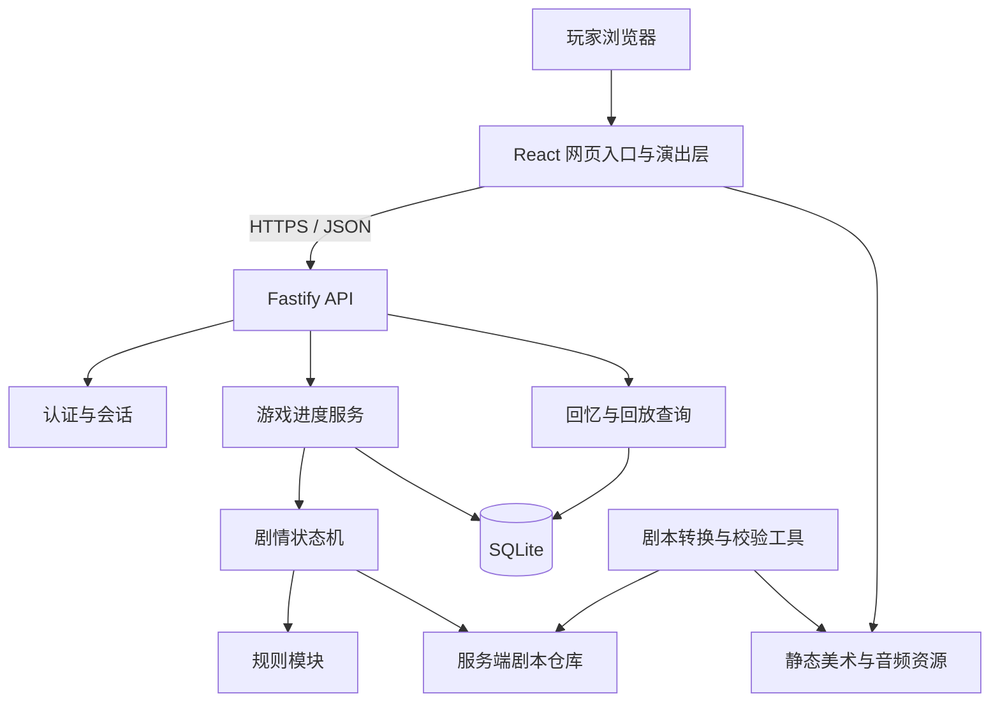

# KP-less 网页跑团游戏：整体架构设计

设计日期：2026-10-08。状态：架构设计，首版实施状态见第 13 节。

目标是把无主持人剧本转换成可独立游玩的网页游戏：玩家创建角色、阅读剧情、选择行动、接受掷骰判定，通过图像、声音和动画体验一条不可回档的剧情线。网站提供剧本库、继续游戏、角色管理、回忆和剧情回放。

首期按单人游玩、联网推进、小规模单机部署设计。一个账号可以拥有多局游戏；同一局只有一个当前进度。多人同步、离线推进和动态生成剧情不属于首期范围。

## 1. 总体选择

采用 **一个前端应用 + 一个模块化后端 + 一个数据库 + 数据化剧本包**。

后端是单进程内按职责拆分的模块；剧本通过内容包扩展，规则通过受信任的代码模块扩展。新剧本通常只增加数据和媒体资源，不修改运行引擎。



推荐技术组合：

| 部分     | 首期选择                                | 原因与边界                                         |
| -------- | --------------------------------------- | -------------------------------------------------- |
| 前端     | React + TypeScript + Vite               | 适合剧本库、角色卡和游玩界面；构建产物静态部署     |
| 后端     | Node.js + TypeScript + Fastify          | 前后端共用语言；认证、进度、剧本等模块分开注册     |
| 数据库   | SQLite，启用 WAL                        | 单机部署简单；事务保证选择、骰子和进度一起提交     |
| 数据访问 | 显式 SQL + 版本化迁移                   | 首期表少，便于审查事务和并发逻辑；集中在后端存储层 |
| 内容     | JSON 剧本包 + JSON Schema 校验          | 可版本化、可检查，避免把每本剧本写成应用代码       |
| 美术音频 | 静态文件 + 资源清单                     | 不经业务 API 传大文件，后续可以接对象存储/CDN      |
| 动画声音 | CSS、Web Animations API、独立音频控制器 | 普通场景用 DOM 实现，复杂粒子效果再增加 Canvas     |
| 通信     | REST                                    | 一人一局的回合式推进不需要持续推送连接             |
| 工程管理 | pnpm workspace                          | 两个应用、少量共享包，统一类型检查和构建           |

SQLite 首期只用于同机的单个 API 实例，数据库放在持久化磁盘上。需要多个写入实例、独立数据库服务或实测写入竞争明显时再迁移 PostgreSQL；迁移通过存储层完成，但 SQL 方言、事务和迁移脚本需要重新验证。

技术依据：[Vite 官方指南](https://vite.dev/guide/)、[Fastify 插件与封装机制](https://fastify.dev/docs/latest/Reference/Plugins/)、[SQLite 适用场景及写入并发边界](https://sqlite.org/whentouse.html)。这里的选型是针对本项目规模的设计判断。

## 2. 前后端职责

**前端负责呈现，后端负责事实。**

| 前端                           | 后端                                     |
| ------------------------------ | ---------------------------------------- |
| 剧本列表、建卡表单、角色卡展示 | 用户认证、会话、角色创建合法性           |
| 当前剧情文本、合法选项展示     | 剧情节点解析、条件计算、合法行动判断     |
| 掷骰动画与判定结果演出         | 骰子随机数、规则判定、角色状态修改       |
| 背景、立绘、音乐、音效、转场   | 剧本版本、当前进度、事件与历史视图持久化 |
| 音量、字体、降低动态效果等偏好 | 回忆和回放的访问控制与数据过滤           |

前端只提交行动意图，例如“选择调查窗户”或“执行当前待判定检定”。客户端提交的骰点、角色数值和目标剧情节点不能决定结果。动画跳过、播放失败或切换设备也不能影响已经提交的进度。

客户端仅接收公开剧本介绍、当前可见内容、已经经历的历史以及必要资源索引。完整剧情图、隐藏条件、未探索正文和判定跳转留在服务端。浏览器中的文本、历史和媒体仍可能被玩家自行保存；本设计约束的是服务器接受的游戏进度与回档行为。

## 3. 模块与依赖方向

后端分为三层：API 处理认证和输入；应用服务组织事务；剧情引擎与规则执行领域逻辑。领域层不依赖 HTTP、数据库或前端。

| 模块        | 职责                                     | 扩展方式                       |
| ----------- | ---------------------------------------- | ------------------------------ |
| auth        | 账号、登录、服务器会话、资源归属检查     | 后续接入第三方登录             |
| catalog     | 剧本公开介绍、可用版本、封面             | 发布新剧本包                   |
| characters  | 建卡流程、属性约束、角色模板             | 每个规则模块声明自己的建卡阶段 |
| runs        | 新建一局、执行行动、事务、幂等与并发控制 | 稳定应用服务                   |
| engine      | 节点、选择、条件、效果、状态转换         | 增加受控节点或效果类型         |
| rules       | 建卡计算、骰子、检定、伤害等             | 受信任的版本化规则模块         |
| history     | 已经历内容、记忆条目、回放帧             | 新增只读展示方式               |
| story-tools | 导入、校验、试跑、发布                   | 离线作者工具                   |

建议首期只创建必要共享包：`contracts` 放 API DTO、内容 Schema 和公开类型；`engine` 放服务端剧情状态机；`rules` 放规则接口和首个规则实现。数据库模型、完整剧本和服务器配置不会作为共享客户端包发布。

规则接口的最小能力：`validateCharacter`、`deriveCharacter`、`resolveCheck`、`applyRuleEffect`。引擎通过显式依赖注入获得规则和骰子来源；测试中可以提供固定骰子，生产中使用服务端密码学随机源。

首个 CoC 规则模块按剧本需求明确支持普通/困难/极难检定、成功等级、大成功/大失败、奖励/惩罚骰，以及属性、技能、当前理智、幸运等不同检定对象。理智是独立的局内可变数值；不能把理智检定长期等同于意志属性。实际计算和幸运消耗、孤注一掷的适用范围在实现前按采用的规则版本逐项核对。未知技能、难度或规则操作应阻止发布或报配置错误，不能静默回退到默认数值。

模块化以清楚的函数接口和固定注册表实现。剧本不能携带可执行 JavaScript；首期不设计运行时第三方代码插件加载器。

## 4. 网页入口与游玩流程

```text
首页 / 剧本库
  → 剧本详情：介绍、规则、预计时长、开始或继续
  → 创建角色：预设角色或按该剧本要求建卡
  → 正式游玩：剧情、行动、检定、角色状态
  → 结局：本局结果、经历回顾、重新开局

我的游戏：当前与已结束的各局
角色档案：可复用的建卡模板
本局回忆：已阅读剧情、发现线索、判定记录
本局回放：按时间重播已发生的剧情与演出
```

角色模板和局内角色分开保存。开局时复制角色模板形成独立角色状态；游戏中受伤、获得物品和修改属性不会污染其他局。同一剧本可以设置专属建卡流程或要求在特定剧情节点完成建卡步骤。

正式游玩界面包含：场景背景与角色立绘、正文/对白、行动区、检定面板、可折叠角色卡、回忆入口，以及静音和降低动态效果控制。移动端采用单列布局。

初始登录方案采用账号密码和服务器会话，密码使用成熟库哈希，Cookie 使用 HttpOnly、Secure 与合适的 SameSite 设置，状态修改接口检查来源/CSRF。后续访客模式可复用同一主体和归属检查；首期不同时实现多套认证方案。

## 5. 剧本包：剧情、规则与演出分离

每个剧本包由以下文件构成：

```text
stories/<story-id>/<version>/
  manifest.json       # ID、版本、规则版本、入口、建卡策略、公开介绍
  nodes.json          # 正文、选择、检定、条件和效果，仅服务端读取
  assets.json         # 资源 ID → 文件位置、类型、授权信息
  locales/            # 可选多语言文本
  source-map.json     # 原书章节/段落 → 节点，供作者审校
```

发布版本不可原地修改。存量游戏固定 `storyVersion`、`rulesVersion` 和 `engineVersion`；更新内容创建新版本。首期仅采用兼容的引擎升级，破坏语义的升级需要保留旧处理器或明确迁移，不能只记录版本号就视作兼容。

正文使用结构化文本块，避免任意 HTML。初始节点类型控制在五类：

| 类型              | 用途                 |
| ----------------- | -------------------- |
| narrative         | 阅读与继续           |
| choice            | 多个带条件的行动选项 |
| check             | 后端掷骰并按规则分支 |
| characterCreation | 与剧情结合的建卡步骤 |
| ending            | 结局与本局终止       |

条件和效果使用白名单结构，例如技能条件、拥有物品、设置标记、修改资源；不用字符串表达式和 `eval`。后续扩展复杂规则时增加具名操作，由规则模块解释。

纸质剧本的“记录表勾选项”转换成具名状态字段：布尔 `flags`、数值 `counters`、物品 `inventory`。它们与角色状态一起写入快照，变化写入事件；公开线索投影到回忆，隐藏标记只供后端判定。选项可以声明显示条件、可执行条件和不可用提示；强制转段由引擎解析，不要求玩家手工遵循正文指令。

剧本包可增加 `characters.json`，存放预设角色的数据，供建卡流程选择。角色卡 UI 和后端判定从同一角色状态读取，避免展示文本与技能数值分开硬编码。

示例仅用于说明内容与演出的关系，字段最终由 Schema 固定：

```json
{
  "id": "inspect-window",
  "type": "check",
  "content": [{ "type": "text", "text": "窗边留下了模糊的痕迹。" }],
  "presentation": {
    "background": "old-house-night",
    "music": "quiet-tension",
    "enter": [{ "type": "fade", "durationMs": 450 }]
  },
  "check": {
    "rule": "skill",
    "skill": "spotHidden",
    "difficulty": "regular",
    "branches": { "success": "find-trace", "failure": "miss-trace" }
  }
}
```

服务端将节点转换为 `SceneView`，包含玩家可见文本、展示用角色状态、合法行动 ID、待检定说明和演出指令。上面的 `branches` 不会传给前端。

剧本源文件转成节点后必须人工校对。EPUB 导入工具可以提取段落、编号和候选跳转，不能仅凭自动提取保证检定、条件和特殊建卡规则准确。当前仓库已有 `scripts/CHA23145 - Alone Against the Flames.epub`，可以作为首个样本；目前两个原作已编译为 `coc7-solo@2`；具体覆盖与适配见 [单人模组实现](solo-modules.md)。

## 6. 单向推进：整个平台最重要的约束

这里的“单向”指 **同一局只追加一次次已确认的经历，不能回到旧状态重新选择**。它不要求原剧本所有地点只能出现一次：如果原剧本要求返回某个地点，这是一条新经历，角色状态继续累积，历史仍然向前。

首次推荐流程：`CREATING_CHARACTER → ACTIVE → ENDED`。`ACTIVE` 内当前阶段可以是阅读、选择、待掷骰或待规则决策。只有当前阶段允许的行动可以提交。

必须保证：

1. 后端根据当前局内状态生成可选行动；请求只能携带行动 ID 与必要输入。
2. 每次行动包含 `expectedRevision` 和 `commandId`；已提交的选择、检定和状态修改不能撤销。
3. 事件、当前状态、历史视图和幂等响应在同一个数据库事务里提交。
4. 同局多标签页/多设备同时提交时，仅一个基于相同 revision 的新行动成功，另一个收到冲突并刷新。
5. 同一个 commandId 重试返回首次已提交的响应；同 ID 不同内容被拒绝。幂等查询在归属校验之后、版本冲突判断之前执行。
6. 骰子结果由服务端产生并持久化；前端收到提交成功的结果后才开始演出。不能通过取消动画、刷新页面或断线重新掷骰。
7. 若规则支持幸运消耗、孤注一掷等二次决策，首次骰点和待决策阶段先提交保存；后续行动受到规则明确约束，不能作为通用重掷入口。
8. 浏览器后退与回忆只改变阅读位置；重新进入游玩页向后端取得唯一当前状态。
9. 已结束的局只能查看；再次游玩创建新 runId，不复制旧局中途状态。

剧情编译器检查节点引用和可达性。对显式剧情循环要求声明退出条件或访问次数上限；自动跳转链需要单次步数上限，以免配置错误导致无限执行。历史以 `visitId` 标识一次访问，不只用 `nodeId`。

事务流程：

```text
校验账号及 run 归属
→ 开启事务，查询是否已有相同 commandId
→ 如果已提交：检查请求一致性并返回已保存响应
→ 否则校验 expectedRevision、当前阶段和行动资格
→ 执行规则、必要随机数、状态变化与后续节点解析
→ 条件更新 run（revision + 1），追加事件与历史视图
→ 保存本次命令及响应，提交事务
→ 返回本次已发生事件 + 当前 SceneView
```

条件更新失败则整个事务回滚；未提交结果不能对外展示。SQLite 通过事务和写入串行化完成首期并发控制；锁等待超时是可重试错误，重试仍使用原 commandId。

## 7. 保存、回忆与回放

采用 **当前状态快照 + 追加事件记录 + 已渲染历史视图**，实现规模控制在本项目需要的范围内。

| 数据       | 用途                                                       |
| ---------- | ---------------------------------------------------------- |
| 当前快照   | 快速继续游戏，保存节点、阶段、角色、标记、资源与 revision  |
| 已发生事件 | 记录选择、骰点、结果、效果、节点进入和结局，便于解释与检查 |
| 历史视图   | 保存当时实际展示的正文、角色变化和演出，稳定提供回忆与回放 |

每次正式行动自动保存。平台不提供多个可读取的存档槽；“继续”恢复服务器最新已提交的状态。阅读滚动位置、音量等可以保存在本地偏好中，它们不改变剧情状态。

回忆是只读浏览，默认按访问顺序显示已读剧情，并提供已获得的线索和判定记录。回放用历史视图重新播放声音和动画，支持暂停、快进、跳到已经历片段，**不调用推进接口，也不重新计算骰子**。

历史接口过滤服务端内部数据，不能直接暴露完整领域事件。资产采用版本化路径和内容哈希，并保留旧局引用的资源；播放失败时正文和既有结果仍然可读。

首期每次行动保存一个必要的历史状态视图，便于任意帧展示角色状态；以后若存储体积成为问题再压缩或采用间隔快照。事件记录不要求首期建成通用事件溯源基础设施。

## 8. 数据表与 API

首期建议八张表：

| 表                  | 关键内容                                                     |
| ------------------- | ------------------------------------------------------------ |
| users               | 账号与认证信息                                               |
| sessions            | 服务器会话及过期时间                                         |
| character_templates | 可复用的建卡模板及规则版本                                   |
| story_versions      | 公开目录元数据、包位置、哈希、版本与发布状态                 |
| runs                | 用户、剧本/规则/引擎版本、状态、revision、当前快照           |
| run_commands        | commandId、请求摘要、已提交响应；唯一键 `(runId, commandId)` |
| run_events          | 有序事件、visitId、内部载荷；唯一键 `(runId, sequence)`      |
| run_history         | 已展示帧、可见角色状态、记忆条目、演出资源引用               |

完整剧本存储在后端内容包目录，数据库维护版本索引；前端静态构建只包含网站代码与明确公开的资源。`run_commands` 保留到本局删除，避免很晚的重试变成新操作。

```text
POST /api/auth/register             创建账号
POST /api/auth/login                登录
POST /api/auth/logout               结束会话
GET  /api/me                        当前用户

GET  /api/stories                   剧本目录
GET  /api/stories/:id               公开介绍与建卡策略
GET  /api/characters                角色模板列表
POST /api/characters                创建合法角色模板

POST /api/runs                      创建一局，固定剧本及规则版本
GET  /api/runs                      我的游戏
GET  /api/runs/:id                  最新 SceneView 与 revision
POST /api/runs/:id/commands          唯一游戏状态推进入口，含建卡行动
GET  /api/runs/:id/history           分页读取已经历剧情
GET  /api/runs/:id/memories          已获得的线索与回忆
GET  /api/runs/:id/replay            分页读取已发生的回放帧
```

所有局内查询和命令都检查归属。一次命令可以产生多个有序事件；响应返回事件列表和最终当前视图，让前端演出中间检定与状态变化。响应与历史使用同一套视图投影规则。

前端断线后的处理：保留正在提交的 commandId，重连重试；成功后按照事件 ID 去重，再获取最新状态。恢复会话时只恢复当前场景和背景音乐，瞬时闪光、震动、一次性音效不自动重播；玩家可主动进入回放观看。

## 9. 动画与音效架构

为美术、音乐和动画设计独立的 `presentation` 层。剧情决定“发生了什么”，演出配置决定“如何呈现”。

```text
SceneView / 已提交事件
  → SceneRenderer：文本、背景、立绘、行动与角色卡
  → PresentationController：排序、跳过、降低动态效果
      → TransitionRenderer：渐变、位移、遮幅、闪光
      → DiceRenderer：掷骰视觉、结果揭示
      → AudioController：音乐循环、交叉淡入淡出、环境音、一次性音效
```

首期演出指令采用白名单，如 `fade`、`shake`、`flash`、`letterbox`、`playSfx`、`setMusic`；包含目标、时长和强度，不能包含脚本。瞬时效果绑定事件 ID，每次访问绑定 visitId。跳过演出立即显示已提交的最终结果，不额外提交游戏行动。

音频区分 BGM、环境声、音效三个通道。进入游戏后由用户手势启用音频；设置提供总静音和分通道音量。背景资源按当前场景加载，预加载范围由后端筛选，避免一次下载完整剧本。降低动态效果偏好关闭震动和密集粒子，保留文字结果。

参考网页：[EpochWeaver 游玩入口](https://epochweaver.com/r/bfb#/play)。本次能取得网页入口 HTML 和其引用的 CSS；静态样式存在卡片入场、受击/治愈反馈、闪光、粒子、震动、电影遮幅等动画定义，也包含部分降低动态效果适配。尚未验证这些效果在指定游玩路由里的实际触发、节奏和交互。

借鉴方向是叙事阶段的渐变与遮幅、检定结果的短反馈、角色状态变化的局部反馈。先保证正文与选择清晰可用，再逐步增加效果；不把参考站的媒体和代码作为项目资产。

## 10. 工程目录与部署

```text
apps/
  web/src/
    pages/                 # 剧本库、建卡、游戏、历史
    features/              # 角色卡、选择、检定、回忆
    presentation/          # 场景、动画、音频
    api/                   # API 调用与恢复逻辑
  api/src/
    modules/               # auth、catalog、characters、runs、history
    storage/               # SQL、迁移、事务
    bootstrap.ts
packages/
  contracts/               # 公开接口、Schema
  engine/                  # 剧情状态机
  rules/                   # 版本化规则实现
stories/                   # 转换后的服务端内容包
assets/                    # 发布用媒体；公开部分使用版本化路径
tools/story/               # 导入、校验、试跑、打包
scripts/                   # 原始材料，独立于公开网站资源
docs/
```

开发时 Vite 将 `/api` 代理到后端；生产时同一域名反向代理 `/api`，其他路径提供前端和静态资源。前后端保持独立构建和部署产物，同时简化 Cookie、CORS 和入口配置。

最小生产部署是静态资源服务器、一个 API 进程和持久化 SQLite 文件。数据库、所有仍被引用的剧本版本与媒体都纳入备份，备份必须支持恢复演练。数据库使用一致性备份机制，不能在 WAL 模式运行时只复制主文件作为完整备份。

业务日志记录 runId、commandId、revision 和耗时，不记录密码或会话令牌。发布工具离线运行，先校验再发布内容版本；首期不需要在线剧本编辑后台。

## 11. 实施顺序与验收

**第一步：把玩法约束落实到引擎。** 用一份十余节点的原创小剧本覆盖建卡、选择、检定、状态修改和两个结局，固定内容 Schema、规则接口与命令事务。

**第二步：交付完整网站闭环。** 认证、剧本库、建卡、正式游玩、自动保存、继续和结局；实现基本背景与声音，并让所有进度从后端读取。

**第三步：完成回忆与回放。** 使用已保存的历史视图，支持检定复看、角色变化、分页和快进，验证只读访问不会改变局内状态。

**第四步：转换首个正式剧本并提高表现力。** 针对 EPUB 的段落与跳转建立 source map，人工校对规则和路径，补齐美术、音乐及关键动画。只有证实的内容需求才扩展引擎。

关键验收：

- 同一个剧本可以创建多局独立游戏，每局角色状态、历史和结局互不污染。
- 双击、多标签页、超时重试和断线恢复不会重复扣资源或重新掷骰。
- 旧 revision 和不属于当前阶段的行动被拒绝。
- 刷新与浏览器后退不能修改已提交的选择；回忆、回放前后状态相同。
- 剧本和规则升级后，旧局仍使用固定版本，回放保持原文和原骰点。
- 非所有者无法读取或推进另一局；客户端不能提交目标节点和有效骰点。
- 剧本发布检查入口、引用、可达节点、终止路径、循环约束、资源引用与规则操作。
- 降低动态效果、静音、媒体加载失败和跳过动画时，仍可完成整局。

重点测试领域规则、真实数据库的事务/幂等/竞争，以及“开局 → 检定 → 刷新继续 → 回放”的端到端路径。内容校验不能替代人工剧本审校，也不能仅靠图可达性证明所有条件分支均可完成。

## 12. 参考仓库：Let-s-play-cocTRPG-

参考地址：[kylin42370/Let-s-play-cocTRPG-](https://github.com/kylin42370/Let-s-play-cocTRPG-)。本次实际读取浅克隆中的源码与剧本文本，检查提交为 `0050b1d251cfaeadf5e4bf3912abdf975657e108`；未安装依赖或执行网页应用。

README 描述的是通用个人网站模板，与实际代码结构不一致。本节以 `streamlit_app.py` 和 `静躁独行.txt` 为依据。它是单文件 Streamlit 互动小说原型，适合作为剧本数字化的功能参考。

| 源码观察                                                                      | 本项目采用的设计                                                   |
| ----------------------------------------------------------------------------- | ------------------------------------------------------------------ |
| `load_story`（11–41 行）用正则提取带编号的段落                                | 保留原段落编号与 source map，增加离线 TXT 导入适配器               |
| `show_character_selection` 提供两张预设角色卡，并生成幸运值                   | 支持预设角色与自建角色；预设数据放进剧本包，随机建卡结果由后端保存 |
| 建卡界面说明记录表勾选项会影响后续选项，并提供外部记录卡链接                  | 将标记、计数与物品纳入后端局内状态，自动控制选项和强制跳转         |
| `get_skill_value`（316–391 行）按角色 ID 硬编码数值，角色卡另有展示文本       | 显示和判定共用结构化角色状态，避免两处定义漂移                     |
| `check_skill_check`（393–461 行）运行时从自然语言识别检定                     | 正则只用于导入阶段产生候选规则；校对后发布结构化检定               |
| `show_game`（527–546 行）接受玩家输入任意有效段落编号                         | 玩家只提交当前合法行动 ID，由后端选择目标节点                      |
| 检定按钮每次执行 `random.randint(1, 100)`，未保存检定结果                     | 事务持久化骰点与状态；重试返回原结果                               |
| 通过 `roll <= skill_value` 判定，并以文字提示成功/失败转段                    | 版本化规则模块处理判定，剧情引擎执行分支，前端展示已确认结果       |
| 页面、角色和幸运值使用 `st.session_state`；源码没有数据库存档、账号与回放实现 | 用数据库保存独立游戏局、事件与历史视图，提供认证和跨会话继续       |

静态导入检查：按仓库 `load_story` 的相同段落正则，从 `静躁独行.txt` 提取到 373 个不重复的编号。这个结果只说明该格式可提取，不证明剧本完整或所有分支有效；该文本还包含记录表、奖励/惩罚骰、理智和孤注一掷等描述，说明完整转换需要表达条件和规则，不能只抽取正文。

导入工具据此采用统一流水线：

```text
EPUB / 编号 TXT
  → 格式适配器：段落、原编号、来源位置
  → 中间表示：正文、候选选择、候选检定、候选标记变化
  → 人工校对：角色、规则、条件、强制跳转、结束条件
  → 编译：结构化节点、角色数据、资源引用
  → 校验与试跑
  → 发布不可变版本的剧本包
```

转换中遇到无法识别的关键指令，应形成带来源位置的待处理项，阻止正式发布，而不是让玩家在游戏中自行输入跳转编号。玩家界面可以显示有叙事意义的段落标签，但原书编号主要供作者审校和问题定位。

两个参考承担不同作用：EpochWeaver 提供演出元素参考，这个仓库提供编号段落、角色与检定的功能参考。前后端分离、认证、持久化和单向推进继续采用本文的架构；本次只提炼设计，没有引入参考仓库的代码或剧本文本。

本设计最先固定的三个契约是 **剧本包格式、单局命令协议、SceneView/历史视图**。它们分别让新剧本、后端规则和前端演出可以独立演进。

## 13. 首版实施状态

2026-10-08 已实现可游玩的基础工程，详细启动方式与边界见仓库 README。

- React/Vite 前端、Fastify 后端、SQLite WAL 与版本化迁移；使用 npm workspace 和锁文件，省去额外包管理器安装。
- 认证与会话独立模块；领域逻辑拆为 contracts、engine、rules；网页建卡、角色卡、弹窗与音频控制独立组件/模块。
- 两个原创短剧本、21 个节点、6 个结局，验证多剧本与条件分支；另有两个正式单人模组，覆盖 642 个原书剧情条目。
- 后端权威掷骰、命令幂等、revision 竞争控制、事务保存、独立局、只读回忆与回放。
- 首期内容包将 manifest、nodes、角色预设合并在一个 story.json，以 Zod 严格校验；后续按内容规模拆文件并导出 JSON Schema。
- 8 张数据表：users、sessions、character_templates、runs、run_commands、run_events、run_history、dice_rolls。剧本版本索引从服务端目录加载，首期无需独立目录表。
- CoC 规则子集支持难度、成功等级与奖励/惩罚骰；v2 支持剧情建卡、战斗、孤注一掷、循环、自动跳转及规则中断返回。通用幸运消耗仍未实现；v1 示例保持原规则。
- 来源可追踪的参考站公开卡背、音乐与检定音效，加原创 SVG 场景；未使用认证信息。动画采用独立 CSS 演出，支持跳过与降低动态效果。
- TXT 导入器可提取编号段落，EPUB 导入器仅提取 HTML 来源片段；输出明确标为不可发布草稿，需人工校对和结构化转换。

已执行领域/API 测试、真实 SQLite 重启恢复测试、桌面/手机浏览器流程、构建与资源校验。认证和进度原型可以本地使用；首期未建立线上部署、运维备份任务或正式内容发布后台。

## 玩家建卡掷骰

除《Flames》剧情建卡外的入口（示例预设、自定义技能、官方模板）先由玩家点击掷幸运骰，再确认角色。规则工厂显式接收已确定的幸运值，创建角色时不调用随机源。复用已有角色无需掷骰。

`POST /api/dice/rolls` 接收玩家操作 ID、用途、面数与颗数；相同 ID 幂等返回已保存点数，修改参数会拒绝。通用骰盘支持 1 至 10 亿面、1 至 100 颗；幸运用途严格固定 3D6。`GET /api/dice/rolls/:id` 仅向该玩家返回历史结果。

普通创建角色或新角色开局必须提交所属玩家的 `luckRollId`（《Flames》开局不需要，幸运骰在剧情内持久化）；后端在同一事务中消费幸运记录、保存档案并记录响应。重试相同创建请求会返回原结果，已消费记录不能用于其他角色。自由骰盘的记录不能用于建卡。SQLite 迁移从版本 1 升至版本 2，保留已有角色和进度。

前端 `DiceRoller` 负责显式点击、断线重试和点数公式；`DiceAnimation` 按面数展示骰形、旋转弹跳与每颗结果，同时用于 D100 剧情检定。动画是已保存结果的演出，支持系统减弱动画与应用简化动画选项。
